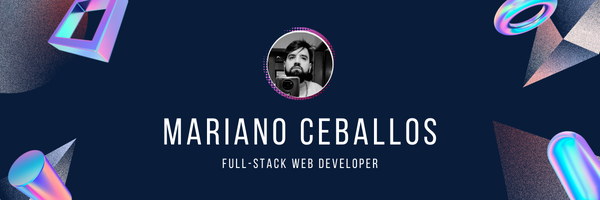

  

  
  
  

## 👋 About me

Full Stack Engineer with 4+ years of experience building web and mobile applications with **TypeScript, React, Next.js, React Native, Node.js (NestJS) and PostgreSQL**.

I build complete products end to end: REST APIs, role-based admin panels, public-facing apps, bilingual (EN/ES) interfaces, automated reports and emails. I care about typed, tested and well-documented code, secure data handling and clear communication at every stage.

Based in Córdoba, Argentina (UTC-3), working remotely. Trained at Henry's Full Stack bootcamp. Open to Full Stack / Software Engineer roles and collaborations.

## 🛠 Tech stack

**Languages**

**Front end & mobile**

**Back end & data**

**Testing, DevOps & tools**

## 📫 Let's connect

- 💼 [LinkedIn](https://www.linkedin.com/in/mariano-ceballos/)
- ✉️ [nanoceballostorres@gmail.com](mailto:nanoceballostorres@gmail.com)
